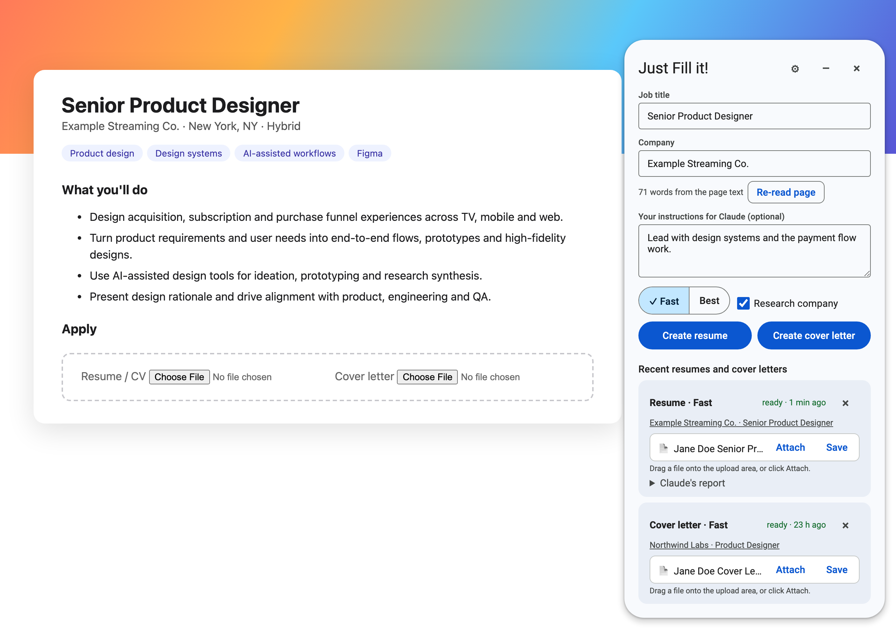
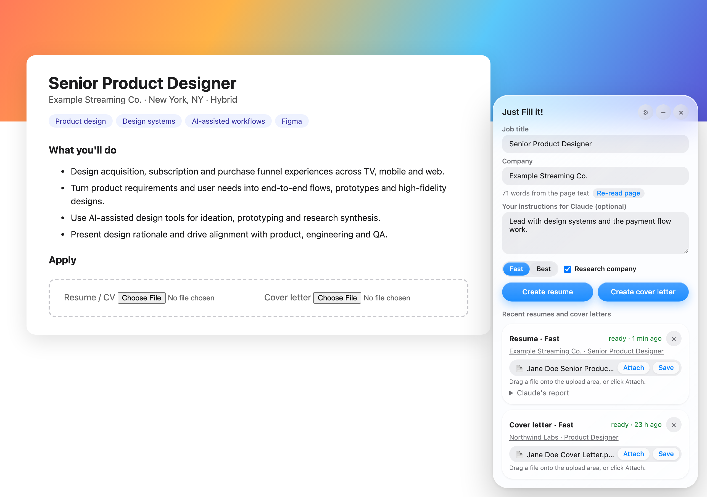
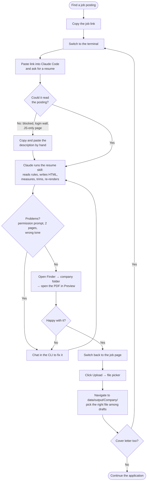
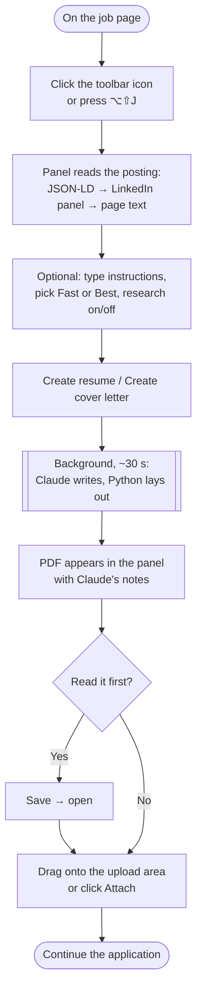
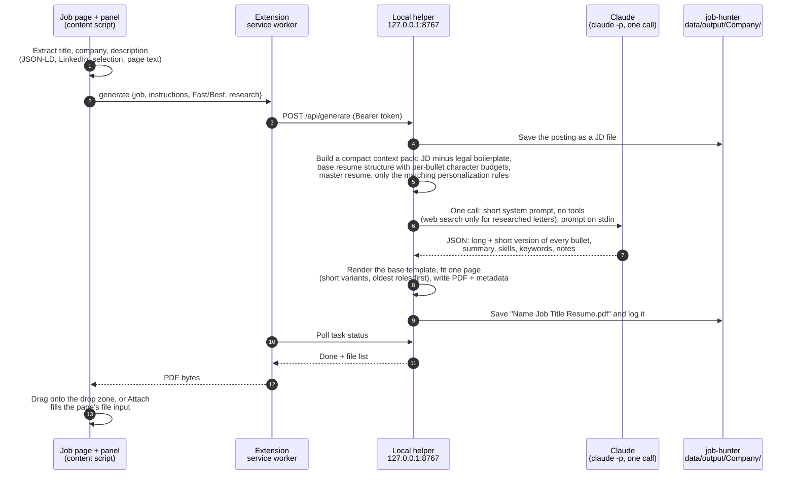
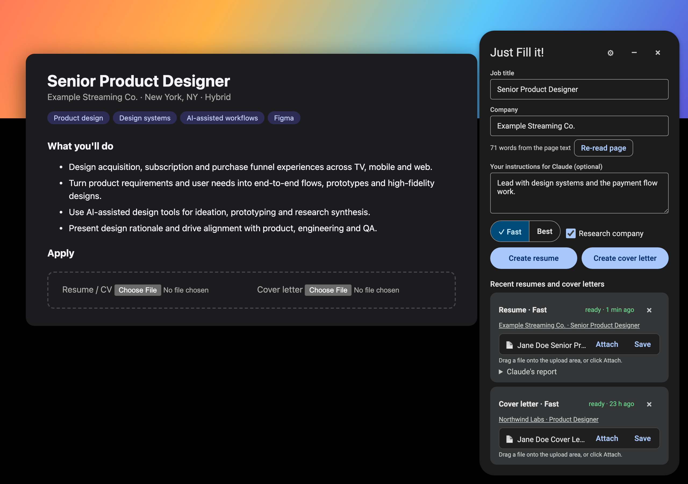
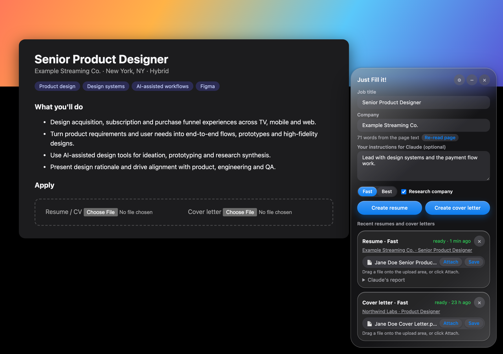

# Just Fill it!

**One click on a job page → a tailored resume or cover letter → dropped straight into the application.**

A Chrome and Safari extension, designed and built by [Apoorv Mahajan](https://apoorvmahajan.framer.website),
AI-native Product Designer. It is the front end of my own job-search tooling: a local helper turns the posting
you're looking at into a one-page resume or a cover letter written by Claude from my real resume and my own
writing rules, then hands the PDF back to the page so it can be dragged onto the upload field.

| Chrome (Material 3) | Safari (Liquid Glass) |
|---|---|
|  |  |

> Screenshots come from `docs/preview/`, which runs the real panel code over a mock posting
> (`uv run python docs/preview/capture.py` regenerates them).

---

## Why I designed this

I'm a product designer looking for my next role, so I apply to a lot of jobs. I already had good tools for the
*writing*: an AI workflow that tailors my resume and cover letter to each posting from my master resume and a
file of rules about how I write. The writing wasn't the problem. **Everything around it was.**

For every single application I was doing this:

1. Copy the job link from the browser.
2. Switch to a terminal and paste it into a Claude Code session.
3. Chat with it to get past whatever came up: a page it couldn't read, a permission prompt, a resume that ran
   onto a second page, a phrase I'd never say.
4. Open Finder, find the PDF, open it in Preview and read it.
5. If something was off, go back to the terminal and repeat steps 3–4.
6. Switch back to the job page, click **Upload**, navigate the file picker to the right company folder, and pick
   the right file out of several drafts.
7. **Do all of it again for the cover letter.**
8. Finally, continue with the actual application.

That's roughly 15 steps, four app switches and two file pickers *per document*, so twice per job, all to move
text from one window to another. It broke my focus every time, and it's where mistakes happened, like uploading
last week's resume to this week's company. Designing for myself made the brief unusually sharp: **I should never
have to leave the job page.**

### Design principles

- **Stay in the flow.** Everything happens in a panel on the page you're already on. No terminal, no Finder,
  no file picker.
- **The human stays in charge of the content.** The panel never submits anything. It hands you a file you can
  read (Save), drag or Attach, and Claude's notes say what it couldn't do honestly (a requirement you don't meet,
  a "send it as a Word file" instruction, sponsorship terms).
- **A place to talk to the model.** A free-text box for this run's instructions ("lead with design systems",
  "keep the letter under 80 words") replaces the back-and-forth chat. It's kept as a draft.
- **Don't lose my work.** The panel survives reloads and page changes, and keeps my last 10 documents (5 shown)
  across tabs and restarts, each linked back to the job it was written for.
- **Feel native.** Material 3 in Chrome, Liquid Glass in Safari: one product in each browser's own design language.
- **Fast and cheap enough to use on every application.** About 30 seconds and ~18k tokens per resume.

---

## Before and after

### Before: the manual loop (per document, twice per job)



### After: Just Fill it!



| | Before | After |
|---|---|---|
| Steps per document | ~15 | 3 (open, create, drag/attach) |
| App switches | 4 (browser, terminal, Finder, Preview) | 0 |
| File pickers | 1–2 | 0 |
| Time per resume | 1–2.5 min of agent time, plus my chat time | ~30 s, no attention needed |
| Tokens per resume | 1.4M–4.4M (22–55 agent turns) | ~13k in + ~5k out (1 call) |

---

## How it works



### The AI design decision that made it usable

The first version let Claude drive my existing resume skill as an agent, with tools. It worked, but each
document took **22 to 55 turns**. Every turn re-sent ~70–80k tokens of context (repo docs, skill instructions,
style guides), and most of those turns were an edit, measure, trim loop to fit one page.

I redesigned the split of work between the model and the code:

- **Claude does only the judgment:** which of my real experiences answer this job, and how to say them in my voice.
- **Python does everything mechanical:** gathering inputs, layout, page fitting, file naming, PDF metadata, logging.
- Claude writes a **long and a short version of every bullet** within character budgets taken from my base
  resume, so Python can fit the page by choosing between them instead of asking the model to rewrite.
- The call runs **outside any repo** with its own short system prompt and no tools, so none of the irrelevant
  context loads.

Result: about 100× fewer tokens, about 5× faster, with the same rules and the same honesty constraints.

### Trust and safety

The panel reads untrusted text (anyone can write a job posting), so the design assumes a posting might try to
manipulate the model:

- The helper listens only on `127.0.0.1`, needs a per-install token, and refuses requests from web pages.
- The posting reaches Claude only inside the prompt. The call has **no tools** except optional web search, no
  MCP servers and no settings files, and it runs from a scratch folder. Its reply is parsed as JSON and
  HTML-escaped into a fixed template, so at worst a hostile posting can skew the wording. That's why reading the
  PDF is one click away.
- Every claim must come from my own resume and rules; Claude's notes flag what it couldn't meet instead of
  inventing it.

---

## Designing for two native systems

Same information architecture, same code, two native skins. The panel checks its own extension URL
(`chrome-extension://` or `safari-web-extension://`) and applies the matching system.

| Chrome: Material 3 (dark) | Safari: Liquid Glass (dark) |
|---|---|
|  |  |

### Google: Material 3 (Material You)

Material 3 has been Google's design system since 2021, and Chrome's own UI has used it since the 2023 "Chrome
Refresh", so a panel that follows it feels like part of the browser. It's built on **tokens**:

- **Color roles from a tonal palette.** Instead of picking hex values per element, every surface and control maps
  to a role: `primary`, `on-primary`, `secondary-container`, `surface-container-low/high`, `outline-variant`.
  I used Google's blue key color (`#0B57D0`) and its dark-theme counterparts, so light and dark both come out right.
- **Elevation through tone, plus shadow.** The panel sits on `surface-container-low` with a level-3 shadow;
  history cards use `surface-container-high`, a step "closer" in tone rather than a heavier shadow.
- **A shape scale.** 28dp corners for the panel (the dialog radius), full-pill 40dp buttons, 4dp outlined
  text fields, 8dp chips for files, and a 16dp tonal *extended FAB* when the panel is minimized.
- **State layers.** Hover and press add an 8% or 12% overlay of the content color instead of changing the fill.
- **Components used as specified:** filled buttons for the two primary actions, an outlined *segmented button*
  with a check mark for Fast/Best, outlined text fields with a 2dp primary focus border, assist-style file chips.
- **Typography:** Google Sans and Roboto in Material's type roles (title-large header, label-large buttons).

### Apple: Liquid Glass

Liquid Glass is the material Apple introduced at WWDC 2025 across iOS 26 and macOS Tahoe. It's meant for the
**controls layer that floats above content**, which is exactly what this panel is: a tool hovering over someone
else's web page. Its principles:

- **A translucent material that lets content show through**, blurring and brightening what's behind it, with a
  bright rim and a specular highlight so it reads as a physical layer.
- **Hierarchy through layering, not borders.** Controls sit in the glass on system *fill* tints (a light grey at
  12% opacity in light mode, 24% in dark) instead of outlined boxes.
- **Capsules and concentric corners.** Pill-shaped buttons and segmented controls; the panel's 28px radius and
  the cards inside it share a centre, so the curves nest.
- **Adaptivity.** The glass tints itself for light and dark, and the system blue accent carries the primary
  actions.

How I approximated it on the web: `backdrop-filter: blur(30px) saturate(190%)` over a translucent fill, an inset
1px rim highlight, a diagonal specular gradient in a `::before` layer, Apple's grey fills for inputs and secondary
buttons, capsule controls and SF Pro. CSS can't do Liquid Glass's true refraction (the lensing at its edges), so
this is an honest approximation, tuned so text and controls keep their contrast over any page.

### What stays the same

Both skins share the layout, order, labels, copy and behavior: header actions (settings, minimize, close), job
fields, instructions, model and research options, the two primary actions, then history. Someone moving between
browsers relearns nothing; only the material changes.

---

## Setup

Just Fill it! is the front end. The backend is my fork of **[job-hunter](https://github.com/Apoorvsm01/job-hunter/tree/apoorv/main)**
(originally by [gpokhark](https://github.com/gpokhark/job-hunter)), which holds the master resume, personalization
rules and output folders. Clone both side by side (job-hunter's `apoorv/main` branch):

```sh
git clone -b apoorv/main https://github.com/Apoorvsm01/job-hunter.git
git clone https://github.com/Apoorvsm01/just-fill-it.git auto_apply_extension
```

```
Job Hunter App/
├── job-hunter/            # backend: config/resume/*, data/output/*
└── auto_apply_extension/  # this repo
```

Requirements: macOS, [uv](https://docs.astral.sh/uv/), [Claude Code](https://claude.com/claude-code) signed in,
and Chrome and/or Safari (Xcode for Safari).

1. **Helper:** `uv sync`, then `sh scripts/install_helper.sh` (a login item, so it always runs in the background;
   or run it by hand with `uv run just-fill-it`). The base resume template comes from a rule in
   `job-hunter/config/resume/personalization.md`: ``start every tailored resume from `data/output/....html` ``.
2. **Chrome:** `chrome://extensions` → Developer mode → Load unpacked → `extension/`.
3. **Safari:** `sh scripts/build_safari.sh` (signs with your Xcode team; `--adhoc` without an Apple ID), then
   Safari → Settings → Extensions → enable **Just Fill it!** and allow it on all websites.
4. In the extension's settings, paste the token from `state/token` (created on the helper's first start, git-ignored).

Tests: `uv run pytest` (no network, no Claude and no browser needed).

## Project layout

```
extension/              the extension (Manifest V3; one codebase for Chrome and Safari)
  content.js            in-page panel, job extraction, drag/attach, Material 3 + Liquid Glass themes
  background.js         talks to the helper, run history, keeps the panel on across page loads
  options.html/.js      token settings
src/just_fill_it/
  server.py             loopback HTTP helper (token, origin and host checks)
  helper.py             JD capture, task queue, the one Claude call
  compose.py            context pack, prompts, JSON validation, layout, page fitting, PDF
safari/                 Xcode wrapper app for Safari (references extension/, no copy)
scripts/                login-item installer, Safari build
docs/preview/           screenshot harness (real panel code, stubbed browser API)
tests/                  helper tests with a fake Claude and a fake renderer
```

---

## Limitations (today)

- **macOS only**, and it needs Claude Code, uv and the job-hunter backend running locally.
- **One-page resume on a fixed base template.** Page fitting picks between the long and short versions Claude
  wrote; it doesn't rephrase after seeing the render, so an occasional awkward line break needs a manual touch.
- **PDF only.** Some employers ask for Word; the notes flag it, but there's no `.docx` yet.
- **Some upload widgets ignore synthetic drops** (they only accept files dragged from the desktop). **Attach**
  covers those; LinkedIn Easy Apply needs its modal open first.
- **Company detection is a guess** on custom career sites without structured data, so check the field before creating.
- **Free Apple signing expires after about a week**; rebuild the Safari app when it stops loading.
- **No preview inside the panel** yet: reading the PDF means Save, then open.
- **History is per browser** (last 10 runs), not synced.
- **The model is trusted to stay truthful.** The rules and notes keep it honest, but nothing verifies claims
  automatically, so read before you send.

## Roadmap

New features are coming soon. Candidates on my list:

- In-panel PDF preview with quick edits and one-click regeneration of a single bullet
- Word (`.docx`) export when a posting asks for it
- Filling the application form's own fields (name, links, work history) from the same profile
- Better company and role detection on custom career sites
- Application tracking: mark a job applied from the panel and sync it to job-hunter's tracker
- Multi-page resumes and more than one base template

---

Designed and built by **Apoorv Mahajan**, AI-native Product Designer ·
[Portfolio](https://apoorvmahajan.framer.website) · [LinkedIn](https://linkedin.com/in/apoorvmahajan)

Licensed under the [MIT License](LICENSE).
